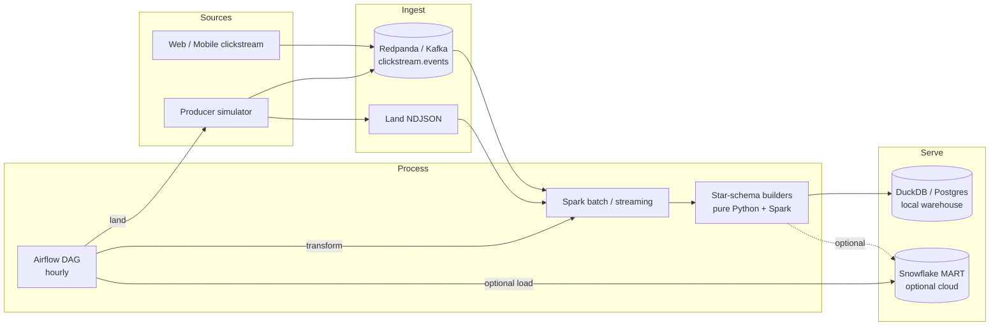

# Real-Time E-Commerce Analytics Pipeline

**Author:** Douae El Assal · **License:** MIT

Production-shaped analytics stack: clickstream events land on Kafka (Redpanda locally), Spark transforms them into a **star schema** (`fact_orders`, `fact_clicks`, `dim_product`, `dim_customer`), Airflow orchestrates **land → transform → load**. The **local stack is first-class** (DuckDB or Postgres warehouse). **Snowflake is an optional cloud sink** when credentials are supplied via environment variables — never hardcoded.

## Architecture



### Data flow (local path — CI and laptop)

1. **Land** — `ClickstreamSimulator` emits JSON events (Kafka when up, else NDJSON).
2. **Transform** — `StarSchemaBuilder` projects events into dims/facts (Spark optional).
3. **Load** — `DuckDBSink` is the default local warehouse; `SnowflakeAdapter` runs offline (plan-only) without credentials, or live when env vars are set.

## Star schema

| Table | Grain | Keys |
|-------|-------|------|
| `dim_product` | 1 row / SKU | `product_sk` ← hash(`product_id`) |
| `dim_customer` | 1 row / customer | `customer_sk` ← hash(`customer_id`) |
| `fact_clicks` | 1 row / event | `click_sk`, FKs to dims |
| `fact_orders` | 1 row / purchase line | `order_sk`, `line_total` |

DDL: [`sql/snowflake/ddl.sql`](sql/snowflake/ddl.sql) · local mirror: [`sql/local/duckdb_ddl.sql`](sql/local/duckdb_ddl.sql)

## Transform complexity

| Job | Complexity | Notes |
|-----|------------|-------|
| `build_dim_*` | **O(n)** catalog | Stable SHA-based surrogates → idempotent SCD1 |
| `build_fact_clicks` | **O(n)** scan | 24h watermark drop is O(1)/event |
| `build_fact_orders` | **O(n)** + **O(1)** price lookup | Line grain; no shuffle in Python path |
| Spark batch | **O(n)** read + broadcast dims | Shuffle partitions = 4 for local; production: Parquet → COPY INTO |
| Streaming `foreachBatch` | micro-batch **O(b)** | Watermark 24h; checkpoint under `data/checkpoints/` |

Critical functions are documented in [`src/pipeline/transforms/star_schema.py`](src/pipeline/transforms/star_schema.py).

## Repository layout

```
├── src/pipeline/
│   ├── schema/          # Pydantic clickstream + order contracts
│   ├── producer/        # Kafka / NDJSON simulator
│   ├── transforms/      # Star-schema builders (tested without cluster)
│   ├── spark/           # Batch + Structured Streaming jobs
│   ├── sinks/           # DuckDB + Snowflake adapter
│   ├── security.py      # Env secrets + log redaction + Kafka SASL helpers
│   └── orchestration/   # Airflow-callable land/transform tasks
├── dags/                # Airflow DAG
├── sql/snowflake/       # Warehouse DDL
├── sql/local/           # DuckDB / Postgres DDL
├── docker/              # App + Airflow Dockerfiles
├── docker-compose.yml   # Redpanda, Spark, Postgres
├── .env.example         # Secrets & config templates (copy to .env)
├── scripts/run_pipeline.sh
├── scripts/run_local_pipeline.sh
└── tests/               # Unit + DuckDB/Kafka integration smokes
```

## Configuration & secrets

```bash
cp .env.example .env
# edit .env — never commit it
```

| Area | Variables |
|------|-----------|
| Local sink | `SINK_BACKEND`, `DUCKDB_PATH`, `CLICKSTREAM_PATH` |
| Kafka | `KAFKA_BOOTSTRAP`; optional SASL: `KAFKA_SECURITY_PROTOCOL`, `KAFKA_SASL_MECHANISM`, `KAFKA_SASL_USERNAME`, `KAFKA_SASL_PASSWORD` |
| Snowflake (optional) | `SNOWFLAKE_ACCOUNT`, `SNOWFLAKE_USER`, `SNOWFLAKE_PASSWORD`, … |
| Postgres compose | `POSTGRES_USER`, `POSTGRES_PASSWORD`, `POSTGRES_DB` |

Logs go through a redacting filter (`pipeline.security`) so password/token values are not echoed. Snowflake credentials are never hardcoded in source.

## Quick start (real local stack)

```bash
python -m venv .venv && source .venv/bin/activate
pip install -r requirements.txt && pip install -e .
./scripts/run_pipeline.sh
# alias:
./scripts/run_local_pipeline.sh
# or
pytest -q
```

`run_pipeline.sh` lands events → builds the star schema → loads DuckDB → **asserts row counts**. This is the real local warehouse path; Snowflake is optional cloud.

## Docker Compose

```bash
docker compose up -d redpanda spark-master spark-worker postgres
# Producer against Redpanda (external listener)
KAFKA_BOOTSTRAP=localhost:19092 python -m pipeline.producer.simulator --count 100 --rate 20
```

Build the pipeline image:

```bash
docker compose --profile tools build pipeline
```

## Airflow

DAG id: `ecom_clickstream_land_transform_load`

```text
land_clickstream → transform_and_load_duckdb → snowflake_adapter_optional
```

Point `PIPELINE_HOME` at the repo root (see `docker/Dockerfile.airflow`) so `src/` is on `PYTHONPATH`.

## Snowflake (optional cloud sink)

```python
from pipeline.sinks import SnowflakeAdapter
adapter = SnowflakeAdapter()  # mode="offline" when env vars missing
adapter.load_star(star)       # records PlannedWrite steps
```

Set `SNOWFLAKE_ACCOUNT`, `SNOWFLAKE_USER`, `SNOWFLAKE_PASSWORD` (and optional warehouse/database/schema/role) from `.env` for a live connector attempt. Never put these values in code or compose image layers.

## CI

GitHub Actions runs pytest on Python 3.11/3.12, then an optional PySpark local smoke with Temurin 17, then `scripts/run_pipeline.sh`.

## License

MIT © Douae El Assal
